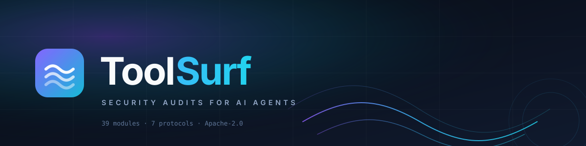

<p align="center">
  
</p>

<p align="center">
  <a href="https://www.npmjs.com/package/toolsurf"></a>
  
  
  
  
  
  
</p>

<h1 align="center">ToolSurf</h1>

<p align="center">
  <strong>Point it at an AI agent. Find out what it can be tricked into doing.</strong><br />
  Security audits for MCP servers, REST APIs, GraphQL, gRPC, A2A, OpenAI functions, and LangChain tools.
</p>

---

ToolSurf is an open-source security scanner for **agent tool interfaces**. It reads what an agent can do — tools, schemas, descriptions, resources, prompts, transports, and auth boundaries — then actively probes the ones you authorize it to touch.

Every protocol is normalized into one analysis engine, so the same 39 modules run whether you're auditing a local MCP server, a remote OpenAPI endpoint, or a gRPC service. Findings carry severity, CWE, confidence, and optional NIST / SOC 2 / OWASP ASVS / HIPAA / PCI DSS / ISO 27001 / FedRAMP mappings.

```
┌──────────────────┐   normalize   ┌──────────────┐   analyze   ┌──────────────┐
│  MCP · REST      │ ────────────► │  Unified     │ ──────────► │  39 modules  │
│  GraphQL · gRPC  │               │  capability  │             │  23 passive  │
│  A2A · OpenAI    │               │  model       │             │  16 active   │
│  LangChain       │               └──────────────┘             └──────┬───────┘
└──────────────────┘                                                    │
                                              findings · score · evidence
                                                    │
                                    ┌───────────────▼────────────────┐
                                    │ terminal · JSON · SARIF · HTML │
                                    │ markdown · research JSON       │
                                    └────────────────────────────────┘
```

## Quick start

```bash
# Zero install
npx toolsurf scan -s "npx -y @modelcontextprotocol/server-filesystem /tmp" --profile quick

# Or install it
npm i -g toolsurf
toolsurf scan -s "npx -y @modelcontextprotocol/server-filesystem /tmp" --profile quick
```

Sample output:

```
  TOOLSURF — SCAN SUMMARY
  ─────────────────────────────────────────────────────────────
  Target       @modelcontextprotocol/server-filesystem
  Protocol     MCP (stdio)
  Profile      quick · passive-only
  Modules      23 run · 22 pass · 1 warn · 0 fail
  Findings     2 (0 critical, 0 high, 1 medium, 1 low)
  Score        86 / 100  ·  Grade B
  Duration     2.4s
  ─────────────────────────────────────────────────────────────
```

Full audit of a running server, with active probes:

```bash
toolsurf scan \
  -s "node ./my-mcp-server.mjs" \
  --profile standard \
  --compliance nist soc2 asvs \
  --output report.sarif
```

## Why another scanner

Most agent security tools stop at "does the tool description contain the phrase *ignore previous instructions*." ToolSurf treats the tool interface as an attack surface:

- **Schema-aware** — understands JSON Schema, annotations, resource URIs, prompt templates, and auth scopes, not just strings.
- **Active by choice** — 16 modules make real calls, fuzz parameters, test session isolation, and verify whether `readOnly` annotations are lies. Passive-only scans never touch the target beyond handshake.
- **Evidence-backed** — active findings can run inside a Docker detonation chamber and be backed by recorded callbacks, not guesses.
- **Protocol-agnostic** — one finding model, seven adapters. Same module, same score, same SARIF, regardless of transport.
- **CI-native** — score gates, SARIF upload, a composite GitHub Action, and stable exit codes.

## Protocols

| Protocol | Adapter | Passive | Active | Notes |
| --- | --- | :---: | :---: | --- |
| MCP (stdio) | `mcp-adapter` | ✅ | ✅ | Spawns the server locally |
| MCP (Streamable HTTP) | `mcp-adapter` | ✅ | ✅ | Remote endpoint, auth headers supported |
| REST / OpenAPI | `rest-adapter` | ✅ | ✅ | OpenAPI 3.x and bare endpoints |
| GraphQL | `graphql-adapter` | ✅ | ✅ | Introspection-based surface discovery |
| gRPC | `grpc-adapter` | ✅ | ✅ | Server reflection |
| A2A | `a2a-adapter` | ✅ | ✅ | Agent cards and skills |
| OpenAI function calling | `openai-adapter` | ✅ | ✅ | Function definitions, not the model |
| LangChain tools | `langchain-adapter` | ✅ | ✅ | Serializable tool schemas |

```bash
toolsurf scan -s "https://api.example.com/openapi.json" --protocol rest-api
toolsurf scan -s "https://agent.example.com" --protocol a2a --profile quick
```

## Scan profiles

| Profile | What runs | Typical time | Use it for |
| --- | --- | --- | --- |
| `quick` | 23 passive modules | ~5s | Pre-commit, PR checks, a first look |
| `standard` | 23 passive + 16 active | ~30s | Normal security review |
| `enterprise` | Full suite + compliance + TUI + autofix + executive summary | ~60s | Release gates, vendor review |

Active modules are always opt-in. `quick` never makes tool calls. Explicit scan modes (`passive-only`, `safe-active`, `full-active`) enforce module risk filtering, so a production target can't accidentally receive destructive probes.

## Modules

<details>
<summary><strong>23 passive modules</strong> — schema, configuration, and capability analysis. No tool calls.</summary>

| Module | Detects |
| --- | --- |
| `tool-permissions` | Over-permissioned schemas, dangerous patterns, annotation trust issues |
| `transport-security` | Insecure endpoints, capability exposure, transport supply-chain risk |
| `schema-manipulation` | Prompt injection in descriptions, schema poisoning, exfiltration patterns |
| `context-extraction` | Tools that can leak conversation context or system prompts |
| `secret-leak-detection` | Credentials and tokens embedded in schemas, descriptions, resources |
| `resource-prompt-audit` | Access control and injection risks in resources and prompt templates |
| `supply-chain-analysis` | Server metadata and naming signals for supply-chain risk |
| `current-vulnerability-intel` | Recently disclosed MCP/agent CVEs matched to package and version evidence |
| `rug-pull-detection` | Tools whose annotations, names, or descriptions contradict their schema |
| `exfiltration-chain` | Multi-tool chains that combine into data exfiltration |
| `namespace-poisoning` | Typosquatting, homoglyphs, name collisions, semantic mismatches |
| `token-exhaustion` | Tools that can blow up the context window or token budget |
| `agentic-loop-trap` | Tool patterns that trap agents in infinite or expensive loops |
| `capability-graph` | Semantic graph of tool capabilities for risk profiling |
| `dangerous-capability` | Arbitrary code, SQL, shell, or unrestricted file operations |
| `description-injection` | Embedded instructions in descriptions and parameter definitions |
| `semantic-injection` | Adversarial instructions that evade regex, via local LLM evaluation |
| `ipi-susceptibility` | Tools that read untrusted content and can serve as indirect-injection vectors |
| `handshake-fuzzer` | OAuth injection, redirect manipulation, protocol spoofing, capability abuse |
| `mcp-apps-audit` | MCP Apps Extension (SEP-1865) XSS, iframe, and postMessage risks |
| `discovery-scanner` | MCP discovery metadata (SEP-1960) compliance and security |
| `eu-ai-act` | EU AI Act Article 15 requirements for high-risk systems |
| `agent-output-trust` | Implicit trust where one tool's output feeds another's input unvalidated |

</details>

<details>
<summary><strong>16 active modules</strong> — make real tool calls. Requires <code>--profile standard</code> or <code>enterprise</code>.</summary>

| Module | Probes |
| --- | --- |
| `output-injection` | Tool outputs for embedded prompt injection |
| `output-injection-detector` | Hidden instructions and data leakage in responses |
| `context-aware-fuzzer` | Domain-specific payloads by tool type (filesystem, database, network, shell) |
| `active-fuzzer` | Parameter fuzzing across six strategies |
| `ssrf-detection` | URL parameters for server-side request forgery |
| `tool-shadowing` | Actual behavior versus declared schema and annotations |
| `response-fingerprinting` | Non-deterministic responses that suggest hidden state or backdoors |
| `auth-boundary-testing` | Whether tools enforce authorization scoping |
| `chained-exploit` | Multi-call attack paths, such as list config → read creds → exfiltrate |
| `annotation-verifier` | Whether `readOnly` annotations are truthful |
| `session-isolation` | Cross-session state leakage |
| `session-state-leakage` | State bleeding between calls in one session |
| `timing-anomaly` | Blind vulnerabilities via response-time differences |
| `state-oracle` | Filesystem artifacts created by probes inside the chamber |
| `adversarial-agent` | A simulated agent following an injected directive, second-order effects included |
| `chamber-evidence` | Reads recorded chamber callbacks and promotes them to evidence-backed findings |

</details>

```bash
toolsurf list-modules    # full list with descriptions
```

## Commands

| Command | What it does |
| --- | --- |
| `scan` | Audit one target |
| `scan-all` | Audit every target in a registry file |
| `scan-source` | Static analysis of server source before deployment |
| `audit-local` | Discover and audit agents configured in local IDEs |
| `audit-target` | Build a reproducible target manifest |
| `audit-repo` | Clone, containerize, and full-active scan a repository |
| `chamber` | Create or operate a Docker detonation chamber |
| `chamber-smoke` | One-shot chamber up → scan → verdict → down |
| `diff` | Compare two reports, show new and fixed findings |
| `badge` | Generate an SVG score badge |
| `hook` | Install or remove a git pre-commit hook |
| `init` | Write a `.toolsurfrc.json` |
| `mock` | Start a shadow MCP proxy for safe active scanning |
| `agent-juice-shop` | Run the multi-protocol benchmark corpus |
| `hardening-check` | Verify the scanner meets its own research-readiness criteria |

## Reports

```bash
toolsurf scan -s "..." -f terminal      # default
toolsurf scan -s "..." -f json
toolsurf scan -s "..." -f html -o report.html
toolsurf scan -s "..." -f markdown
toolsurf scan -s "..." -f sarif -o report.sarif
toolsurf scan -s "..." --compliance all
```

Every report includes findings with severity, confidence, evidence, remediation, CWE, and optional compliance controls. `diff` makes regressions visible between releases.

## CI/CD

### GitHub Action

```yaml
name: Agent security
on: [pull_request]

jobs:
  toolsurf:
    runs-on: ubuntu-latest
    steps:
      - uses: actions/checkout@v4
      - uses: volodymyrshk/toolsurf@main
        with:
          server: "npx -y @modelcontextprotocol/server-filesystem ."
          profile: standard
          fail-below: "80"
          sarif: toolsurf.sarif
      - uses: github/codeql-action/upload-sarif@v3
        if: always()
        with:
          sarif_file: toolsurf.sarif
```

### Any CI

```bash
toolsurf scan -s "$TARGET" --profile standard --ci --fail-below 80
```

`--ci` disables color and progress, emits machine-readable output, and returns a non-zero exit code on findings. Use `--min-severity` and `--min-confidence` to keep gates focused.

### Git hook

```bash
toolsurf hook install
```

## Configuration

ToolSurf reads, in order:

1. `.toolsurfrc.json`
2. `.toolsurfrc`
3. `toolsurf.config.json`

```json
{
  "profile": "standard",
  "compliance": ["nist", "soc2"],
  "minSeverity": "MEDIUM",
  "failBelow": 80,
  "plugins": ["./toolsurf-plugin-custom.js"]
}
```

Other files and variables:

| Thing | Name |
| --- | --- |
| Ignore file | `.toolsurfignore` |
| Custom rules | `.toolsurf-rules.yml` / `.toolsurf-rules.json` |
| Plugin packages | `toolsurf-plugin-*` |
| Plugin directory | `~/.toolsurf/plugins/` |
| Non-interactive acceptance | `TOOLSURF_ACCEPT=true` |

## Extending

A module is a class with an `id`, `mode`, and a `run(context)` method that returns checks. Register it in `packages/cli/src/core/module-catalog.ts`.

```typescript
import type { AuditModule, ModuleContext, CheckResult } from "../types/index.js";

export class MyModule implements AuditModule {
  id = "my-module";
  name = "My Check";
  description = "Detects a specific class of tool-interface risk";
  version = "1.0.0";
  mode = "passive" as const;

  async run(context: ModuleContext): Promise<CheckResult[]> {
    return [];
  }
}
```

See [CONTRIBUTING.md](CONTRIBUTING.md) for the module contract, compliance mappings, and test guidance.

## Benchmark

ToolSurf ships with **Agent Juice Shop**, a deterministic multi-protocol corpus of intentionally vulnerable agent servers. It exists so detection changes can be measured rather than asserted.

```bash
toolsurf agent-juice-shop
```

See [docs/AGENT-JUICE-SHOP.md](docs/AGENT-JUICE-SHOP.md).

## Documentation

| Document | Contents |
| --- | --- |
| [docs/ARCHITECTURE.md](docs/ARCHITECTURE.md) | Pipeline, adapters, module runner, scoring |
| [docs/KNOWN-LIMITS.md](docs/KNOWN-LIMITS.md) | What ToolSurf does not detect, and why |
| [docs/AGENT-JUICE-SHOP.md](docs/AGENT-JUICE-SHOP.md) | Benchmark design and expected results |
| [SECURITY.md](SECURITY.md) | Reporting vulnerabilities in ToolSurf itself |
| [LEGAL_NOTICE](LEGAL_NOTICE) | Authorized-use policy |

## Development

Requires [Bun](https://bun.sh) 1.1+ and Node.js 20+.

```bash
git clone https://github.com/volodymyrshk/toolsurf.git
cd toolsurf
bun install
bun run dev -- scan -s "npx -y @modelcontextprotocol/server-filesystem /tmp" --profile quick
bun run test        # 930 tests
bun run typecheck
bun run build
```

Current suite: **926 passing, 4 skipped, 0 failing** across 93 files.

## Disclaimer

ToolSurf is for **authorized security testing only**. Scan systems you own or have explicit written permission to test. Active modules make real tool calls and can modify state; run them against disposable targets or inside the detonation chamber, not production. You are responsible for complying with the law and with the target's terms of service. See [LEGAL_NOTICE](LEGAL_NOTICE).

ToolSurf is an independent project. It is not affiliated with, endorsed by, or sponsored by Anthropic, OpenAI, Google, Microsoft, or any vendor whose protocols it audits. Product names and trademarks belong to their respective owners.

## License

[Apache-2.0](LICENSE). See [NOTICE](NOTICE) for attribution.

Built by [Volodymyr Shkarban (@volodymyrshk)](https://github.com/volodymyrshk).

## Citation

```bibtex
@software{toolsurf,
  author  = {Shkarban, Volodymyr},
  title   = {ToolSurf: Security audits for AI agents and tool interfaces},
  year    = {2026},
  url     = {https://github.com/volodymyrshk/toolsurf},
  license = {Apache-2.0}
}
```

A [`CITATION.cff`](CITATION.cff) is included for GitHub's citation UI.
